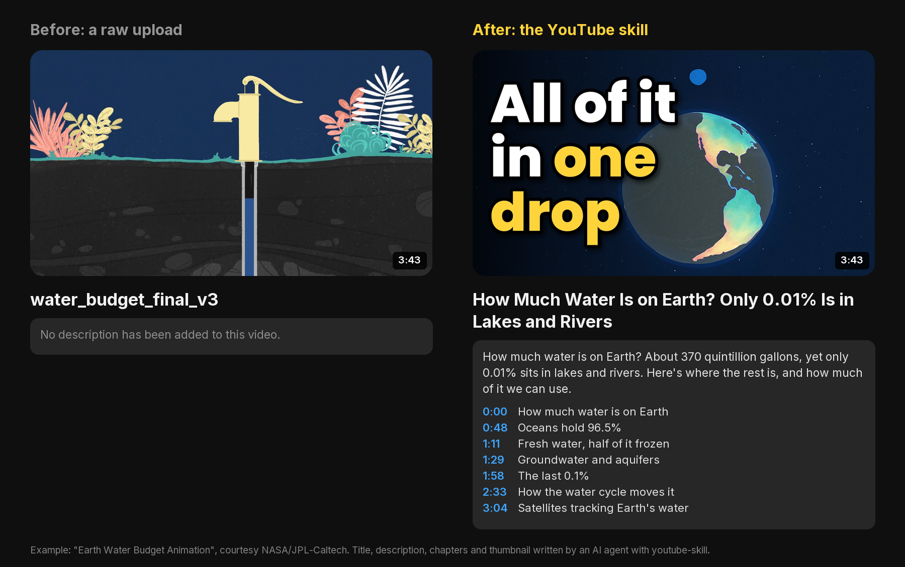

# YouTube Skill for Claude Code, Codex, Cursor and OpenClaw

**YouTube Skill** is a free, open-source AI agent skill for YouTube SEO and uploading. It turns a finished video into an upload people can find. Claude Code, Codex, Cursor, OpenClaw and other agents that run scripts use it to:

- transcribe the video;
- find the phrases people actually type into YouTube search;
- write 10 titles, a description whose first lines work in search, chapters, tags and hashtags;
- check every field against YouTube's limits;
- render thumbnail options from the video's own frames and show them at the size viewers see them;
- write a clean caption file;
- upload to YouTube after you say yes, with a short list of what to finish in YouTube Studio.

Everything runs on your own machine with Python, ffmpeg and Pillow. No paid API required. MIT licensed.

```bash
npx skills add social-media-skills/youtube-skill -g -a claude-code -y
```



*A 3:43 animation packaged in [`examples/water-budget/`](skills/youtube-skill/examples/water-budget/). It covers the main phrase "how much water is on earth" (YouTube's top suggestion for the topic), a title of 61 characters, a description that answers the question in its first line, 7 chapters, 8 tags, captions and 3 thumbnail ideas. The video is "Earth Water Budget Animation", courtesy NASA/JPL-Caltech; the text and thumbnails were written by an AI agent with this skill, as an example. See [CREDITS](skills/youtube-skill/examples/water-budget/CREDITS.md).*

## Contents

- [What the YouTube skill does](#what-the-youtube-skill-does)
- [Requirements](#requirements)
- [Install](#install)
- [Example: publish a video to YouTube with Claude Code](#example-publish-a-video-to-youtube-with-claude-code)
- [What it checks](#what-it-checks)
- [Thumbnails](#thumbnails)
- [Output](#output)
- [Uploading to YouTube](#uploading-to-youtube)
- [What it won't do](#what-it-wont-do)
- [FAQ](#faq)
- [What's inside](#whats-inside)
- [License and credits](#license-and-credits)

## What the YouTube skill does

Tell your agent "upload this to YouTube", "write my YouTube title and description" or "make a thumbnail" and it does the publishing work from start to finish:

1. **Checks the machine.** `check_setup.py` reports Python, ffmpeg, Pillow, transcription routes and the optional extras, with the install command for your system.
2. **Asks only what it can't see.** Which file, what the channel is about, and two settings YouTube needs you to declare:
   - whether the video is made for kids (a legal setting);
   - whether it shows realistic AI-made or AI-altered content.

   It never guesses either of them.
3. **Transcribes the video** from an existing SRT or VTT file, your own Groq or OpenAI key, or free local faster-whisper. Every word of the package is written from what the video actually says.
4. **Finds the search phrase.** `suggest.py` reads what people type into YouTube search for the topic and its question forms. The agent picks the most specific phrase the video fully answers. With your own free YouTube Data API key it also lists the 10 videos ranking now, with views per day.
5. **Writes the package:**
   - 10 titles to pick from, with the phrase early and under 70 characters;
   - the description's first lines, which show in search;
   - chapters named for what the viewer gets;
   - 5 to 10 specific tags and 3 hashtags;
   - the category and a comment to pin.
6. **Checks it all.** `youtube_pack.py` checks lengths, bytes, the phrase placement, the chapter rules, the tag budget and the legal settings, and moves chapter starts to the start of a sentence.
7. **Makes thumbnails from the video.** It scores candidate frames for sharpness, light and faces, then renders 2 or 3 different ideas and a preview of each in the home feed and in the small "up next" card.
8. **Uploads after you say yes** through WoopSocial, unlisted or scheduled. It ends with a short checklist for YouTube Studio: thumbnail, captions, AI use, end screen, playlist and a Test & Compare A/B test.
9. **Reads the results** after 2 and 7 days. It uses a simple table: low click-through means test another thumbnail or title; viewers leaving early means a tighter opening next time.

## Requirements

Python 3.8 or newer, ffmpeg (any build) and Pillow. It runs on Mac, Windows and Linux; a CI workflow builds a pack and renders thumbnails on all three.

| System | ffmpeg | Pillow |
|---|---|---|
| macOS | `brew install ffmpeg` | `pip install pillow` |
| Windows | `winget install ffmpeg` | `pip install pillow` |
| Linux (Debian, Ubuntu) | `sudo apt install ffmpeg` (or your distro's package manager) | `pip install pillow` |

On Windows, use `py` instead of `python3` in the commands below.

Transcription, pick one:

- An existing `.srt` or `.vtt` file: free and instant.
- `pip install faster-whisper`: free and private, roughly half to one times the video's length on a laptop.
- `GROQ_API_KEY` (about $0.04 per hour of audio) or `OPENAI_API_KEY`: fast, and the audio is sent to that provider.

Optional:

- `pip install opencv-python-headless` scores faces when picking thumbnail frames; the face model is included.
- A free YouTube Data API key (`YOUTUBE_API_KEY`) shows what ranks now. The default quota is 100 searches a day.

The skill needs an agent that can run ffmpeg on your computer (Claude Code, Codex, Cursor, OpenClaw or similar).

## Install

**Claude Code**

```bash
npx skills add social-media-skills/youtube-skill -g -a claude-code -y
```

**Codex, Cursor and other agents:** run `npx skills add social-media-skills/youtube-skill` and pick your agent, or copy `skills/youtube-skill/` into your agent's skills directory.

**OpenClaw (ClawHub):** `openclaw skills install @social-media-skills/youtube-skill`

**GitHub CLI:** `gh skill install social-media-skills/youtube-skill youtube-skill`

**Gemini CLI:** `gemini extensions install https://github.com/social-media-skills/youtube-skill`

## Example: publish a video to YouTube with Claude Code

```
You:   Put water.mp4 on my YouTube channel. Make it findable.

Agent: ffmpeg and Pillow are ready. Two settings YouTube needs from you:
       is it made for kids, and does it show realistic AI-made footage?

You:   Not for kids, no AI footage. Upload unlisted first.

Agent: Transcribed from the video's caption file. YouTube's top suggestion
       for the topic is "how much water is on earth", and the video
       answers exactly that. Ten titles; my pick (61 characters):
       "How Much Water Is on Earth? Only 0.01% Is in Lakes and Rivers".
       7 chapters from 0:00, 8 tags, 3 hashtags, no warnings.
       Three thumbnail ideas are in preview.png: Earth drained dry next
       to "All of it in one drop", the surfer with "96.5% is salt water",
       and the full 370-quintillion figure with no words.

You:   Title is good. Thumbnail a.

Agent: Validated. Unlisted upload to your channel now, title as above,
       Education, not made for kids. Post?

You:   Yes.

Agent: Uploaded: youtube.com/watch?v=... In Studio: upload thumb-a.jpg,
       then captions.srt, then make it public. Want b and c in Test &
       Compare as well?
```

Every file from this run is in [`examples/water-budget/`](skills/youtube-skill/examples/water-budget/):

- the spec, the transcript and the search suggestions;
- the upload pack and the description;
- the captions and the post body;
- the thumbnails and the preview.

The video itself isn't in the repo; [`CREDITS.md`](skills/youtube-skill/examples/water-budget/CREDITS.md) links to it.

## What it checks

| Field | Rule | Why |
|---|---|---|
| Title | 100 characters at most; warns past 70; the search phrase in it, early; no all caps; no `<` `>` | Titles are cut in feeds; YouTube refuses `<` `>` |
| Description | 5,000 bytes (the API counts bytes, so emoji count more); the phrase in the first 150 characters; no stock "In this video..." opening | The first lines are what shows under the video and in search |
| Chapters | First at 0:00, at least 3, each at least 10 seconds, inside the video; starts moved to the sentence start | Break one rule and YouTube shows no chapters at all |
| Tags | 500 characters as YouTube counts them (commas and quotes included) | YouTube says tags matter little; mainly for misspellings |
| Hashtags | Letters, digits and underscores only; more than 60 and all are ignored; up to 3 show above the title | |
| Made for kids | Must be set by you | A legal setting (COPPA) |
| Category | Must be a real YouTube category | |
| Shorts | Vertical or square and 3 minutes or less: no chapters, no `#shorts` needed | |
| Captions | Transcript length matches the video | So captions line up |

The rules and their sources, checked in October 2026, are in [`references/youtube-seo.md`](skills/youtube-skill/references/youtube-seo.md).

## Thumbnails

```bash
python3 scripts/youtube_pack.py frames final.mp4 --out pack/
python3 scripts/thumbnail.py thumbs.json --out pack/
```

- **Frames from the video.** `frames.jpg` shows 12 candidates, chosen for sharpness, light, colour and faces, with near-duplicates dropped. The chosen frame is the sharpest within a quarter second, so motion blur is avoided.
- **Three layouts:**
  - `side`: big white words on a dark fade;
  - `box`: dark words on coloured bars;
  - `none`: the picture alone.

  `zoom` and `focus` crop in on the subject. Highlighted words take the accent colour.
- **The right size.** It renders at the source's size, up to 3840x2160 (YouTube's recommendation), and keeps each file under 2 MB so it also uploads from a phone. The bottom-right corner is kept clear for the duration badge.
- **Judged where it's seen.** `preview.png` puts every option, with your title, in the desktop home feed and in the small card used for "up next" and phone search. If the words can't be read there, the option is rejected.
- **Bundled fonts:** Poppins ExtraBold for the words, Inter for the preview.

## Output

`scripts/youtube_pack.py build` turns the agent's `upload.json` into:

- **`upload-pack.md`:**
  - the whole package on one page for your approval;
  - title options and where titles get cut;
  - the description's first lines as they show;
  - chapters and settings;
  - the YouTube Studio checklist.
- **`description.txt`:** the full description, with chapters, links and hashtags.
- **`captions.srt`:** clean captions (fillers and speaker tags removed, names fixed with `replace`), at most 2 lines of 42 characters.
- **`post.json`:** the WoopSocial post body, with the two IDs left to fill in.
- **`manifest.json`:** file size, duration, Short or not, warnings.

## Uploading to YouTube

Uploading goes through [WoopSocial](https://woopsocial.com/?utm_source=youtube-skill&utm_medium=readme), a social media API and MCP server for AI agents. Disclosure: this skill is maintained by Frank Heijdenrijk and the team behind WoopSocial. The free plan covers 2 social accounts, with everything from posting to analytics included. Setup steps for every agent are at [woopsocial.com/agents](https://woopsocial.com/agents?utm_source=youtube-skill&utm_medium=readme).

The agent uploads the video and builds the YouTube post: title, description, tags, category, made for kids, privacy and schedule. It validates the post and shows you everything before it posts, and it posts only after a clear yes.

WoopSocial doesn't write your text or edit your video; the skill builds the package locally and you approve it. WoopSocial doesn't set the thumbnail, captions, playlist, end screen or the AI-use label either, so `upload-pack.md` ends with those steps for YouTube Studio. A safe first upload is unlisted. If you'd rather not connect anything, the skill hands you the pack to upload yourself.

## What it won't do

- Write a title, thumbnail or claim the video doesn't deliver. Misleading packaging breaks YouTube's spam policy and loses viewers in seconds.
- Guess whether a video is made for kids or contains realistic AI-made content.
- Use images, faces or logos you have no rights to.
- Mass-produce near-identical uploads. YouTube's spam policy bans flooding a channel with automated, repetitive videos; every package is written from that video's own transcript.
- Post before you approve the post.
- Report numbers YouTube didn't return. Missing means "not reported", not zero.

## FAQ

**How do I write a YouTube title that ranks?**
Pick one specific search phrase the video fully answers, from what people type into YouTube search, and put it early in a title under 70 characters, together with a reason to click that the video keeps. The skill finds the phrase, writes 10 titles and checks the one you pick.

**Do YouTube tags still matter?**
Very little. YouTube says tags mostly help when a word is commonly misspelled. The skill writes 5 to 10 specific tags and puts its effort into the title, the description's first lines, chapters and the thumbnail.

**How do I add chapters to a YouTube video?**
Put timestamps in the description: the first at 0:00, at least three, in order, each at least 10 seconds long. The skill writes them from the transcript and checks every rule, because breaking one means YouTube shows no chapters at all.

**What size should a YouTube thumbnail be?**
YouTube now recommends 3840x2160 (16:9), at least 640 pixels wide, JPG or PNG, under 2 MB if you upload from a phone. The skill renders at the source's size up to that and keeps files under 2 MB.

**Can Claude Code upload videos to YouTube?**
Yes, with this skill and WoopSocial connected. Claude Code builds the package, uploads the video and creates the YouTube post after you approve it. Thumbnails and captions are added in YouTube Studio.

**Is there a free YouTube title, description and tag generator?**
This skill does all three for free on your own machine, written from your video's transcript rather than from a template, and checks them against YouTube's limits.

**Does it work for YouTube Shorts?**
Yes. Vertical or square videos up to 3 minutes are handled as Shorts: no chapters, no `#shorts` needed, and the custom thumbnail is added in Studio on a computer.

**Does it work on Windows and Linux?**
Yes. It needs Python 3.8+, ffmpeg and Pillow, and CI tests it on Mac, Windows and Linux.

**Is it free?**
The skill is MIT licensed and free. Search suggestions and local transcription cost nothing. Uploading through WoopSocial is free for 2 social accounts; more accounts need a paid plan.

## What's inside

All of it lives in [`skills/youtube-skill/`](skills/youtube-skill/):

| File | What it does |
|---|---|
| `SKILL.md` | The workflow the agent follows |
| `scripts/check_setup.py` | Checks Python, ffmpeg, Pillow, transcription routes and optional extras, with install commands |
| `scripts/transcribe.py` | Transcribes with word timestamps (existing SRT/VTT, Groq, OpenAI or local faster-whisper) |
| `scripts/suggest.py` | YouTube search suggestions for a topic; with your own API key, the videos ranking now |
| `scripts/youtube_pack.py` | Checks `upload.json` and writes the pack; `frames` picks candidate thumbnail frames |
| `scripts/thumbnail.py` | Renders thumbnail options and the feed preview |
| `scripts/upload_parts.py` | Uploads the video to a WoopSocial upload session |
| `references/youtube-seo.md` | Limits, titles, descriptions, chapters, tags, thumbnails, Shorts and policies, with sources |
| `references/woopsocial.md` | Connect, upload, post and read results |
| `fonts/` | Poppins and Inter (SIL Open Font License) |
| `models/` | YuNet face detector (MIT) for frame scoring |
| `examples/water-budget/` | A worked example |
| `evals/evals.json` | Test scenarios for the skill |

## More free social media skills

More skills for social media work: [social-media-skills.com](https://social-media-skills.com)

## License and credits

MIT. Poppins and Inter are under the SIL Open Font License (`skills/youtube-skill/fonts/`). The YuNet face detection model is by Shiqi Yu and contributors, MIT licensed (`skills/youtube-skill/models/LICENSE-YuNet.txt`).

The example video is "Earth Water Budget Animation", courtesy NASA/JPL-Caltech, from [images.nasa.gov](https://images.nasa.gov/details/JPL-20221111-EARTHf-0001-Earth%20Water%20Budget%20Animation). NASA material is generally not subject to copyright in the United States. No endorsement by NASA, JPL or Caltech is implied. The example's text and thumbnails were written by an AI agent using this skill; they are not NASA's words.
